# Portly

Android app to control access to a gated community: residents generate their own QR code to enter and exit, and can create temporary QR codes for their guests.

> Status: **stage 8** features are complete (navigation and screens). Features that depend on a server are still pending (see below).

## Screenshots

| Login | My QR | Guests |
|:-:|:-:|:-:|
| 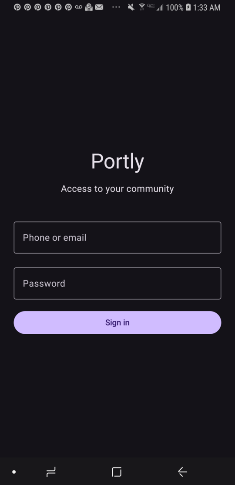 | 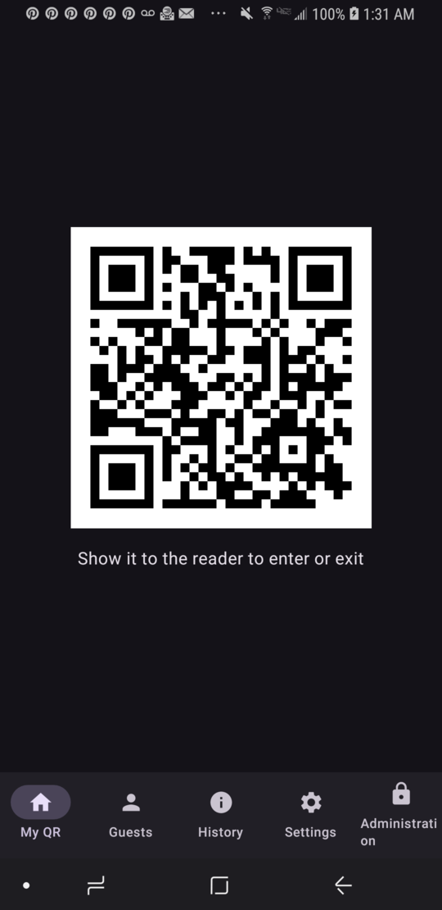 | 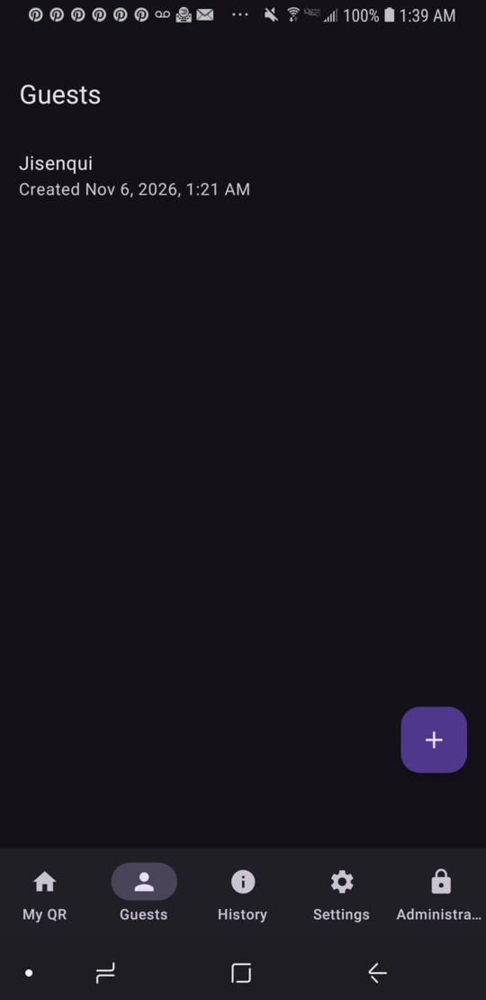 |

| Create guest | Guest QR | History |
|:-:|:-:|:-:|
| 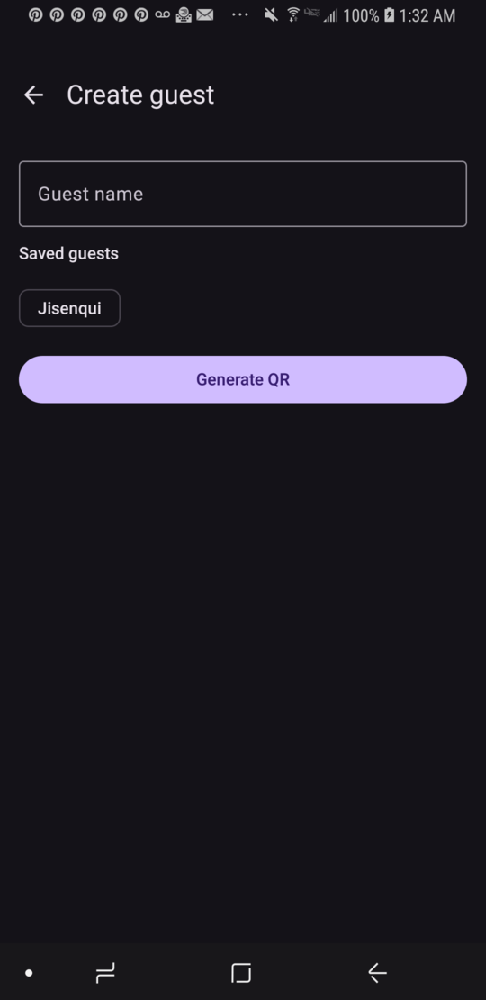 | 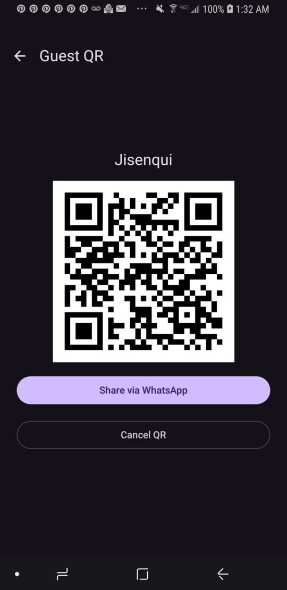 | 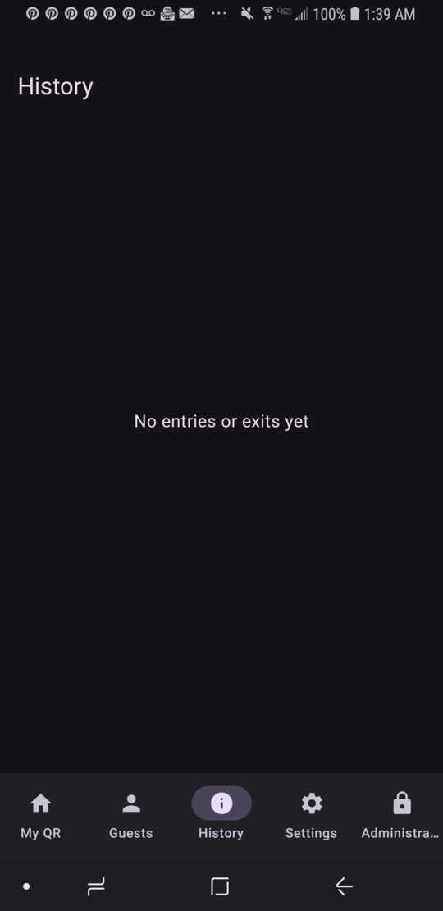 |

| Settings | Guest notifications | Administration |
|:-:|:-:|:-:|
| 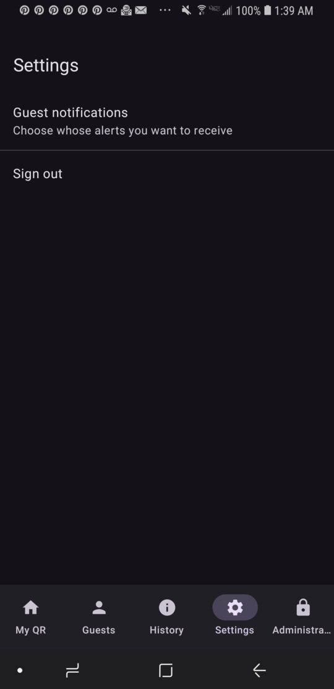 | 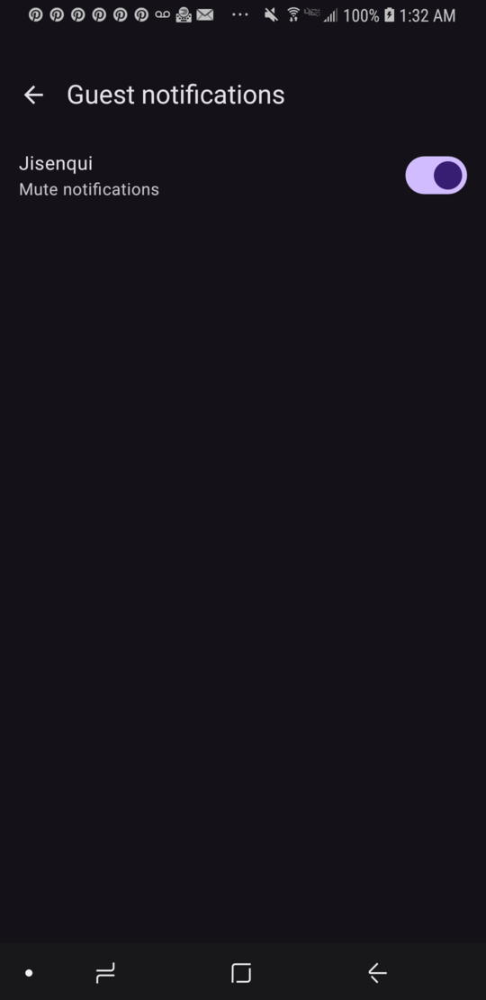 | 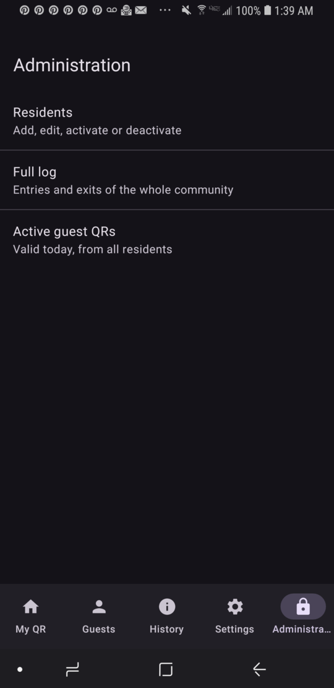 |

| Residents | Full log | Active guest QRs |
|:-:|:-:|:-:|
| 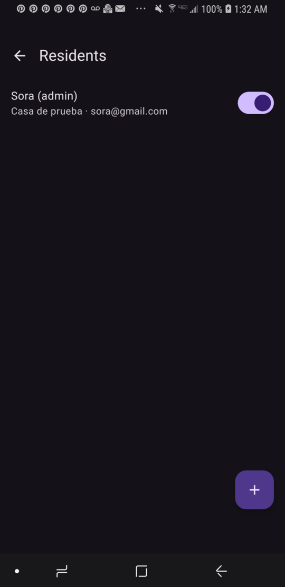 | 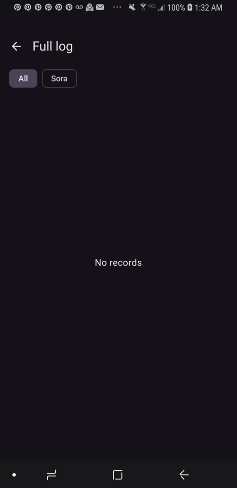 | 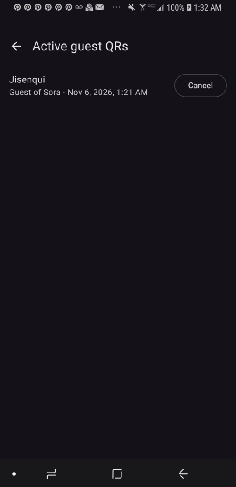 |

## Features

- **Login** with a contact (phone or email) and a password. Passwords are stored hashed with PBKDF2; the session is kept in DataStore.
- **My QR:** the resident's own code to enter and exit.
- **Guests:** a resident creates a guest by name and generates their QR. The QR is only valid on the day it was created, with no limit on uses that day. The image can be shared via WhatsApp, or the QR can be cancelled.
- **History:** every entry and exit with time, person and the resident who invited them.
- **Settings:** notifications per guest, plus a general "Mute all guests" switch (shown with 2 or more guests, and it overrides the individual ones).
- **Administration** (administrators only): add, edit, activate or deactivate residents; view the full log filtered by resident; and cancel active guest QRs. A resident is never deleted, so the history is preserved.
- **Languages:** Spanish (default) and English, following the phone's language.

## Tech stack

- Kotlin, Jetpack Compose and Material 3
- Navigation Compose, ViewModel with Flow, and Hilt
- Room for the local database
- DataStore and Android Keystore for the session and secrets
- ZXing to generate the QR codes
- Android 8.0 (API 26) or higher

## Architecture

```
ui/           Compose screens and ViewModels (one screen, one ViewModel)
domain/       business rules and models (no Android dependencies)
data/         Room, DataStore, security, QR generation
di/           Hilt modules
```

The services in `domain/` (authentication, QR, history, notifications, administration) receive their dependencies through interfaces, so they are tested on the JVM with fakes and MockK.

## Build and test

```bash
./gradlew testDebugUnitTest   # unit tests
./gradlew installDebug        # install on a connected device
```

## Pending (requires a server)

- QR validation on the gatehouse computer.
- Real "X entered" and "X left" notifications (FCM).
- Backup of the guest list, which is currently lost when changing phones.
- Define the initial administrator.

## Development plan

The stage-by-stage plan is in [`app/PLAN.md`](app/PLAN.md) (in Spanish).
